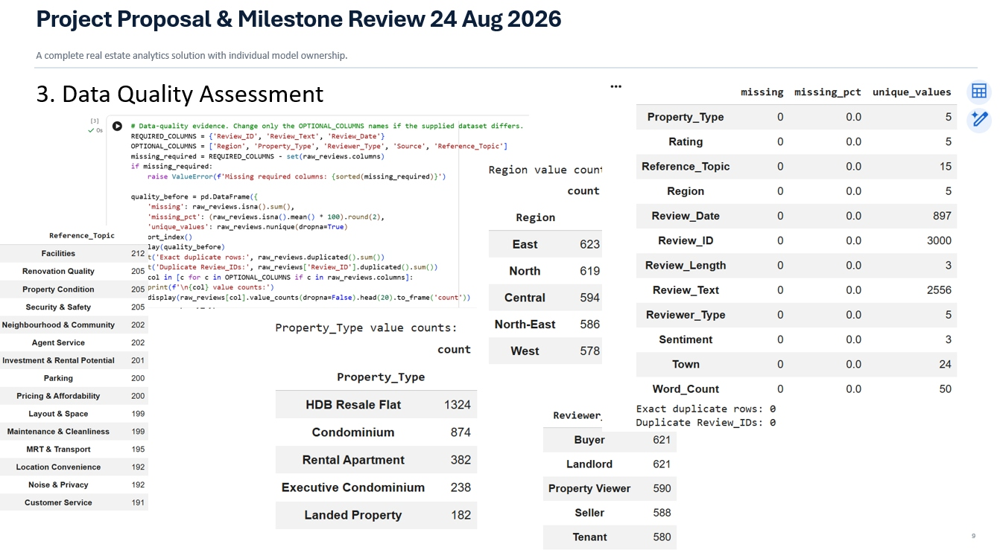
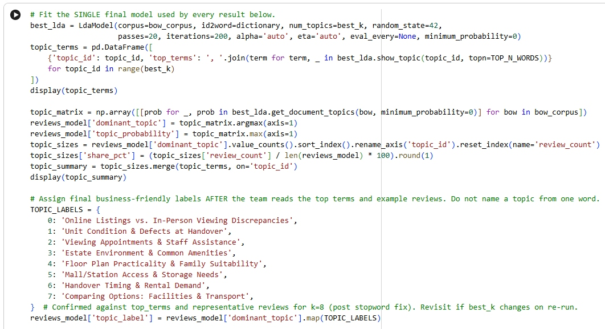
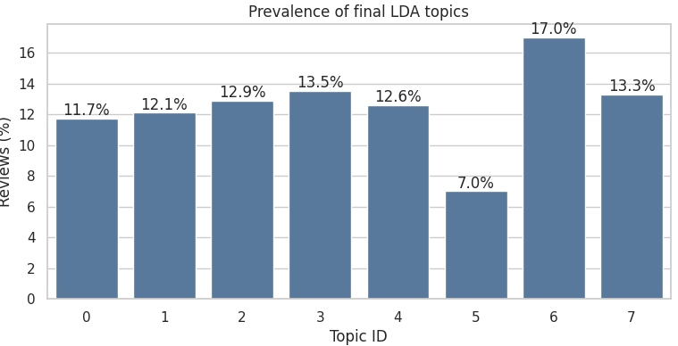
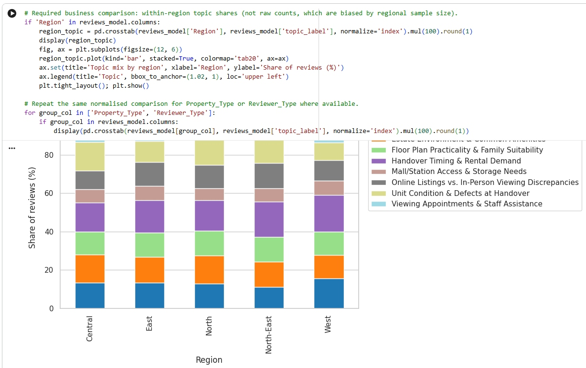
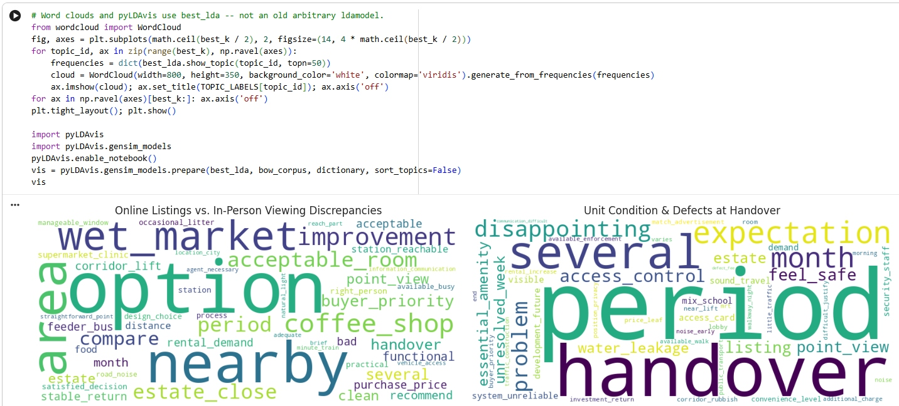
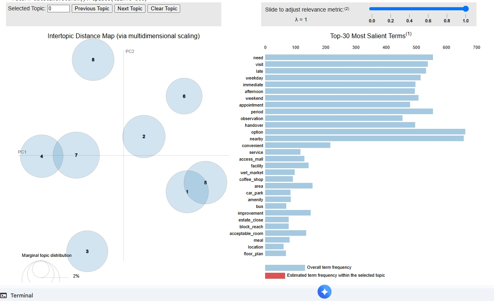

# Singapore Property Reviews: LDA Topic Modelling

Individual project by Tan Tien Hock (ID: 6968437D). The project finds the main concerns in 3,000 synthetic Singapore property reviews with a single, reproducible LDA workflow. It then compares those concerns by region, property type, reviewer type and year.

## Repository Structure

```
.
├── README.md
├── requirements.txt
├── notebooks/Reviews_Topic_Modelling.ipynb
├── data/3000_Synthetic_Property_Reviews.csv
└── images/            # screenshots used below
```

## Dataset

- 3,000 synthetic reviews, 12 columns (Review_ID, Review_Date, Property_Type, Region, Town, Reviewer_Type, Reference_Topic, Sentiment, Rating, Review_Length, Word_Count, Review_Text).
- 5 regions (Central, East, North, North-East, West), 5 property types, 5 reviewer types, 24 towns.
- No missing values, no duplicate rows and no duplicate Review_IDs. All 3,000 records were kept after cleaning.
- The reviews are synthetic and contain no personally identifiable information.



## Method

1. Data quality assessment and cleaning (raw data kept untouched for audit).
2. Text preprocessing: tokenisation and lemmatisation with NLTK, plus stopword handling.
3. One gensim Dictionary and bag-of-words corpus (3,000 documents, 305 terms, min_df = 15) shared by every candidate model.
4. Model selection over k = 5 to 8 using mean c_v coherence. **k = 8** scored highest (0.305, sd 0.024).
5. Final LDA fit: `random_state=42`, `passes=20`, `iterations=200`, `alpha='auto'`, `eta='auto'`.
6. Validation with the most representative reviews per topic, then business comparisons and an optional sentence-embedding sanity check.



| k | Mean coherence | SD | Mean log perplexity |
|---|---|---|---|
| 5 | 0.245 | 0.011 | -4.782 |
| 6 | 0.273 | 0.037 | -4.751 |
| 7 | 0.291 | 0.028 | -4.732 |
| 8 | 0.305 | 0.024 | -4.708 |

## Results

| Topic | Label | Reviews | Share |
|---|---|---|---|
| 0 | Online Listings vs. In-Person Viewing Discrepancies | 350 | 11.7% |
| 1 | Unit Condition & Defects at Handover | 362 | 12.1% |
| 2 | Viewing Appointments & Staff Assistance | 387 | 12.9% |
| 3 | Estate Environment & Common Amenities | 406 | 13.5% |
| 4 | Floor Plan Practicality & Family Suitability | 378 | 12.6% |
| 5 | Mall/Station Access & Storage Needs | 209 | 7.0% |
| 6 | Handover Timing & Rental Demand | 509 | 17.0% |
| 7 | Comparing Options: Facilities & Transport | 399 | 13.3% |



### Regional comparison

Topic shares are normalised within each region, so uneven regional sample sizes do not bias the comparison.



### Word clouds and pyLDAvis





## How to Run

```bash
pip install -r requirements.txt
jupyter notebook notebooks/Reviews_Topic_Modelling.ipynb
```

The notebook loads the CSV by filename. Keep a copy of `3000_Synthetic_Property_Reviews.csv` beside the notebook, or set `DATA_FILE` in the load cell to `../data/3000_Synthetic_Property_Reviews.csv`.

## Limitations and AI Ethics

- Privacy: the data is synthetic, with no personal information.
- Fairness: reviewer-type language overlaps with topic terms, which can bias topics.
- The reviews are synthetic and may not be representative. Sentiment is not validated, and 2026 is a partial year.
- LDA topics are exploratory associations, not causal findings. Review volume alone should not be used to infer prices or demand.
